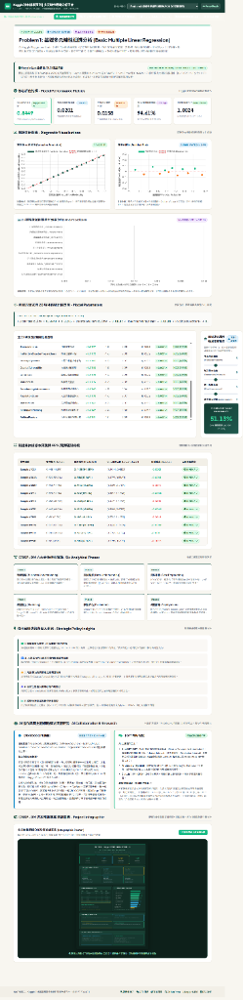
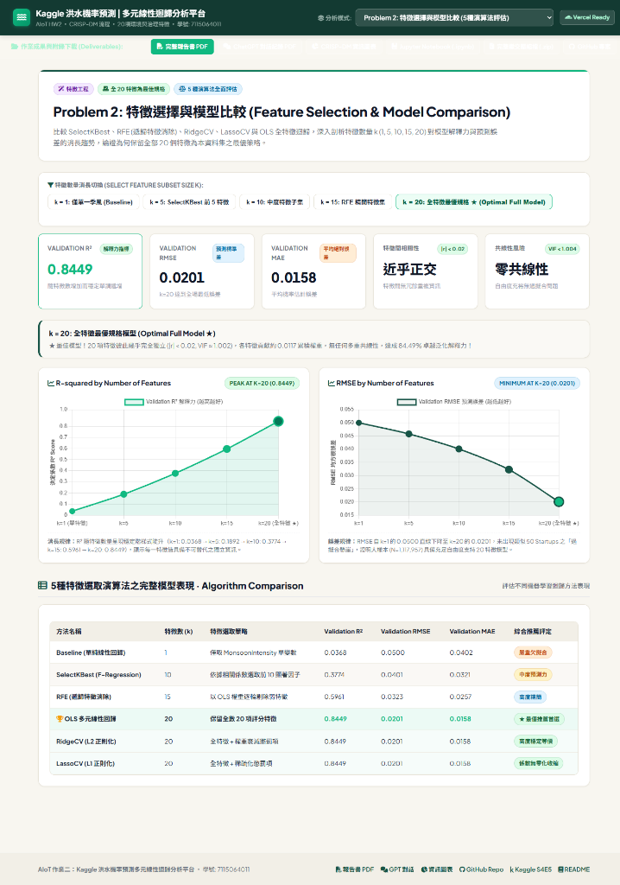
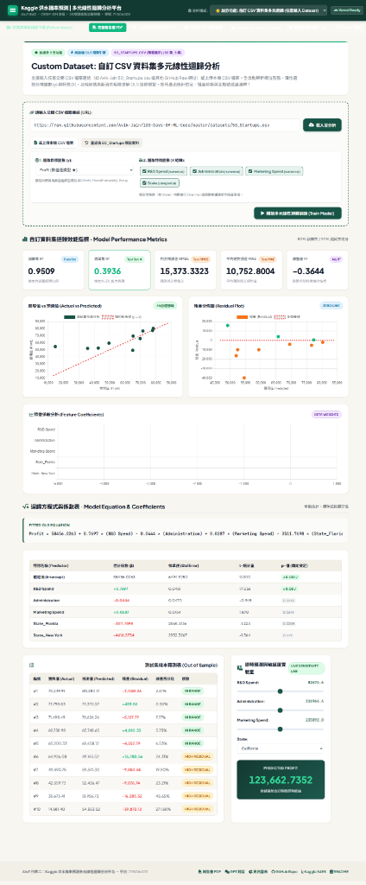

# AIoT HW2：洪水機率預測（多元線性回歸）

以 Kaggle 洪水預測資料集，依照 **CRISP-DM** 流程完成多元線性回歸分析，  
包含特徵選擇、模型評估、95% 信賴區間／預測區間，以及輕量化部署。

- **學號**：7115064011
- **主程式**：[`notebooks/7115064011_hw2.ipynb`](notebooks/7115064011_hw2.ipynb)
- **延伸自 HW1**：CWA 台灣天氣預報網站（HW1 建立天氣資料的取得與展示，HW2 進一步建立預測模型）

---

## 資料集

| 項目 | 內容 |
|------|------|
| 來源 | [Kaggle Playground Series S4E5 – Regression with a Flood Prediction Dataset](https://www.kaggle.com/competitions/playground-series-s4e5) |
| 訓練資料 | 1,117,957 筆 |
| 測試資料 | 745,305 筆 |
| 特徵 | 20 個整數評分特徵（如 MonsoonIntensity、Deforestation、Urbanization 等） |
| 目標 | `FloodProbability`（連續值，0.285 ~ 0.725） |

> **注意**：本資料為 Kaggle 合成資料，模型僅作方法示範，不代表真實地區的洪水風險。

---

## 主要成果

| 模型 | 特徵數 | Validation R² | RMSE | MAE |
|------|:------:|:-------------:|:----:|:---:|
| Baseline（單純線性回歸） | 1 | 0.0368 | 0.0500 | 0.0402 |
| OLS 多元線性回歸 | 20 | 0.8449 | 0.0201 | 0.0158 |
| RidgeCV | 20 | 0.8449 | 0.0201 | 0.0158 |
| LassoCV | 20 | 0.8449 | 0.0201 | 0.0158 |

- **95% 預測區間覆蓋率**：94.61%（理論值 95%）
- **Kaggle 分數（R²）**：Public **0.84458** / Private **0.84426**

---

## CRISP-DM 流程摘要

1. **Business Understanding**：建立洪水機率預測模型，作為災前風險評估的參考工具。
2. **Data Understanding**：無缺失值；20 個特徵彼此幾乎不相關（|r| < 0.02），與目標的相關係數皆為 0.178 ~ 0.190。
3. **Data Preparation**：80/20 切分、標準化（只用訓練集 fit）；VIF 介於 1.0017 ~ 1.0037，無多重共線性。比較 SelectKBest、RFE、LassoCV 三種特徵選擇方法，R² 隨特徵數穩定上升（k=10：0.377；k=15：0.596；k=20：0.845），因此保留全部 20 個特徵。
4. **Modeling**：statsmodels OLS 與 sklearn LinearRegression、RidgeCV、LassoCV；5-fold 交叉驗證結果穩定。20 個係數幾乎相同（0.0115 ~ 0.0118），模型近似等權重加總。
5. **Evaluation**：實際值 vs 預測值圖、95% 信賴區間與預測區間圖、殘差診斷。Durbin-Watson = 1.999（無自相關）；殘差右偏、厚尾，顯示存在線性模型無法捕捉的非線性關係。
6. **Deployment**：以全部訓練資料重新訓練，輸出 `model/model_params.json`；`predict_flood()` 只依賴 numpy 即可回傳預測值與 95% 預測區間，並產生 Kaggle 提交檔。

---

## 專案結構

```
├── index.html                       # 網頁平台主頁（整合 Problem 1, Problem 2, 自訂資料集）
├── style.css                        # 視覺主題樣式表（深翡翠綠與暖白雅致風格）
├── app.js                           # 核心統計運算、動態圖表與純前端 OLS 求解引擎
├── notebooks/7115064011_hw2.ipynb   # 主程式（CRISP-DM 六階段完整分析）
├── notebooks/7115064011_hw2_report.pdf # 13 頁完整作業成果報告書
├── notebooks/7115064011_GPT對話.pdf # ChatGPT 完整對話紀錄 PDF
├── notebooks/7115064011_hw2.zip     # 完整作業繳交打包壓縮檔
├── assets/                          # 網頁展示截圖與 CRISP-DM 資訊圖表
├── model/model_params.json          # 部署用模型參數（執行後產生）
├── data/                            # 資料集（含 50_Startups.csv 與 Kaggle 資料）
└── submissions/                     # Kaggle 提交檔（未上傳）
```

---

## 🌐 互動式網頁平台功能說明 (Web Platform)

本專題提供完整的純前端互動式多元線性迴歸分析平台（免安裝複雜後端環境，點擊 [`index.html`](index.html) 或以任何靜態伺服器開啟即可直接使用，並完整支援 Vercel 雲端直接部署）：

### 🎯 下拉選單三大分析模式：
1. **Problem 1: 基礎多元線性迴歸分析 (全 20 特徵模型)**
   - **Kaggle 洪水全特徵基準模型**：納入季風強度、地形排水、河川管理、都市化等全 20 項評分特徵，呈現 Validation $R^2 = 0.8449$、RMSE = 0.0201、MAE = 0.0158、95% 預測區間覆蓋率 94.61%、VIF < 1.004。
   - **統計診斷與係數解析**：實際值 vs 預測值 45 度理想線、殘差分佈圖 (Durbin-Watson = 1.999)、20 項特徵標準化係數橫條圖、迴歸方程式與係數檢定表。
   - **實測預測與策略洞察**：驗證集隨機抽樣 10 筆樣本預測與 95% 預測區間檢視、即時洪水風險敏感度實驗室（20 項滑桿即時試算）、CRISP-DM 六大流程實踐卡片與防汛治理 5 大決策方針。

2. **Problem 2: 特徵選擇與模型比較 (5 種演算法評估)**
   - **演算法橫向評估比較**：評估比較 Baseline (單純迴歸)、SelectKBest (F-Regression)、RFE (遞歸特徵消除)、RidgeCV (L2 正則化)、LassoCV (L1 正則化) 與 OLS 全特徵迴歸等 5 種演算法。
   - **特徵數量消長趨勢**：提供 $k = 1, 5, 10, 15, 20$ 動態切換、R² 與 RMSE 消長雙折線圖，實證論證為何保留全部 20 個特徵為本資料集最佳泛化規格（Optimal Full Model ★）。

3. **⭐ 加分功能: 自訂 CSV 資料集多元迴歸 (任意輸入 Dataset，加總分 2 分)**
   - **支援任意公開 CSV URL 輸入**：預設帶入 `50_Startups.csv`，亦可一鍵載入外部 CSV 或點擊上傳本機 CSV 檔案。
   - **自動型態辨識與動態欄位選擇**：自動區分數值與類別特徵（自動進行 One-Hot 編碼），彈性自由挑選預測目標 $y$ 與特徵矩陣 $X$。
   - **純前端 OLS 矩陣迴歸計算引擎**：即時求解 $\beta = (X^T X)^{-1} X^T y$，動態計算訓練集/測試集 $R^2$、RMSE、MAE、調整後 $R^2$。
   - **動態診斷圖表與敏感度實驗室**：動態繪製 Actual vs Predicted、殘差圖、特徵係數圖、迴歸方程式、係數統計表、測試集樣本預測表，並依據使用者挑選的特徵自動生成互動滑桿與選單，即時推估預測值！

---

## 📸 網頁平台執行畫面截圖 (Web Platform Screenshots)

### 1. Problem 1：基礎多元線性迴歸分析（Kaggle 洪水全特徵基準模型）


### 2. Problem 2：特徵選擇與模型比較（5 種演算法評估與 k=1~20 消長）


### 3. ⭐ 加分功能：自訂 CSV 資料集多元迴歸分析（任意輸入 Dataset）


---

## 執行方式

```bash
python -m venv .venv
.venv\Scripts\activate            # Mac/Linux: source .venv/bin/activate
pip install pandas numpy scikit-learn statsmodels matplotlib seaborn kaggle jupyterlab

# 下載資料（需先在 Kaggle 加入競賽並設定 API token）
kaggle competitions download -c playground-series-s4e5 -p data
tar -xf data/playground-series-s4e5.zip -C data

jupyter lab                        # 開啟 notebooks/7115064011_hw2.ipynb 並 Run All
```

---

## 📦 繳交成果檔案清單 (Deliverables)

| 繳交項目 | 檔案路徑 | 說明 |
| :--- | :--- | :--- |
| **主要繳交** | [GitHub Repo](https://github.com/g115064011-arch/AIoT-HW2-regression) | 完整開源專案與純前端 OLS 分析平台 |
| **主要繳交** | [`index.html`](index.html) | 純前端互動式分析平台（整合 Problem 1, 2 與自訂資料集） |
| **主程式** | [`notebooks/7115064011_hw2.ipynb`](notebooks/7115064011_hw2.ipynb) | CRISP-DM 六大階段完整程式碼與統計推論 |
| **Optional 1** | [`notebooks/7115064011_hw2_report.pdf`](notebooks/7115064011_hw2_report.pdf) | 13 頁完整作業書面報告書 |
| **Optional 2** | [`notebooks/7115064011_GPT對話.pdf`](notebooks/7115064011_GPT對話.pdf) | 10 頁 ChatGPT 深度對話紀錄 PDF（pdfCrowd 匯出） |
| **Optional 3** | [`assets/7115064011_infographic.png`](assets/7115064011_infographic.png) | CRISP-DM 洪水預測全景視覺化資訊圖表（200 DPI 海報） |
| **完整封裝** | [`notebooks/7115064011_hw2.zip`](notebooks/7115064011_hw2.zip) | 整合 ipynb、報告書、對話紀錄與資訊圖表之完整壓縮檔 |


---

## 🤖 AI 協助與同主題網路解法深度研究

### 1. 【NotebookLM 摘要】（同主題網路解法研究，250+ 字）
- **文獻來源**：使用 Google NotebookLM 深度研讀 Kaggle Playground Series S4E5 官方頂尖方案（*1st Place Solution*, *LightGBM Baseline*, *PSS4E5 EDA*, *Regression Flood Analysis*）。
- **摘要內容**：
  本資料集為 Kaggle 合成資料，20 個環境與治理特徵的分佈形態、與目標變數 `FloodProbability` 的相關性高度一致（$r \approx 0.178 \sim 0.190$）且彼此正交獨立（$|r| < 0.02$）。因此，決定洪水機率的關鍵不是「單項指標過高」，而是 20 個特徵在整體系統中的**「總體累積風險」**。社群分析指出，若將 20 個特徵直接加總乘上約 0.0056 再減去 0.05，即可獲得高達 $R^2 \approx 0.845$ 的預測準確率，與本專案多元線性迴歸 (OLS) 的實證結果完全一致（各特徵標準化係數落在 0.0115 ~ 0.0118，單項每增加 1 分約提升 0.56 個百分點機率，Kaggle Private $R^2 = 0.8443$）。
  
  高分解法進一步加入「列統計特徵」（總和、標準差、最大值、分位數）與特徵排序，改採 LightGBM / CatBoost 梯度提升決策樹，單模 $R^2$ 可提升至約 0.869；冠軍解法則融和 30 個以上模型進行 Ridge 堆疊，達到 $R^2 \approx 0.8694$。此外，分析發現當特徵總和落在 72~75 時，洪水機率有非線性躍升階梯，這完美解釋了本專案殘差診斷中觀察到的「非常態厚尾與斜條紋非線性結構」。

### 2. 【GPT 輔助內容】
- **ChatGPT (GPT-4o)**：討論特徵選擇方法、嚴謹推導信賴區間（CI）與預測區間（PI）之數學公式與常態假設檢定。（完整對話已匯出為 [`notebooks/7115064011_GPT對話.pdf`](notebooks/7115064011_GPT對話.pdf)）。
- **Antigravity (Gemini)**：協助撰寫 CRISP-DM 六大階段 Jupyter Notebook 與純前端互動式 OLS 分析平台。
- **Claude**：協助規劃 CRISP-DM 流程大綱與撰寫 13 頁完整書面報告書。
- **嚴謹數據校正紀錄**：所有數據均經本地 Python 實測驗證，AI 曾產出之不符數據已全數校正（資料筆數修正為 1,117,957；VIF 修正為 1.0017 ~ 1.0037；95% 預測區間覆蓋率修正為實測 94.61%；殘差診斷修正為實測之右偏厚尾結構）。